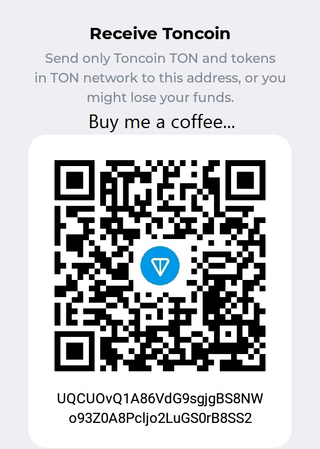

# ❤️ Support TextTranslator

TextTranslator is free to use and has no advertisements. If it is useful to you, an optional contribution can help support future development.

**Suggested support: US$1 — entirely voluntary.** You may choose any amount, or nothing at all. No feature is locked behind a donation.

**USDT (TRC20):**

`UQCUOvQ1A86VdG9sgjgBS8NWo93Z0A8Pcljo2LuGS0rB8SS2`

Please verify the selected network before sending. Sending assets over a different network may result in permanent loss.

Thank you for supporting an independent project. ❤️

---

# حمایت از TextTranslator

استفاده از TextTranslator رایگان است و افزونه تبلیغات ندارد. اگر برایتان مفید بود، می‌توانید برای ادامهٔ توسعه از پروژه حمایت کنید.

**مبلغ پیشنهادی: ۱ دلار آمریکا؛ کاملاً اختیاری.** هر مبلغ دیگری یا حتی عدم پرداخت کاملاً قابل قبول است و هیچ قابلیتی به حمایت مالی وابسته نیست.

**USDT روی شبکه TRC20:**

`UQCUOvQ1A86VdG9sgjgBS8NWo93Z0A8Pcljo2LuGS0rB8SS2`

پیش از ارسال، شبکهٔ انتخابی را با دقت بررسی کنید. ارسال دارایی روی شبکهٔ اشتباه ممکن است باعث از دست رفتن همیشگی آن شود.

از حمایت شما از یک پروژهٔ مستقل سپاسگزاریم. ❤️
